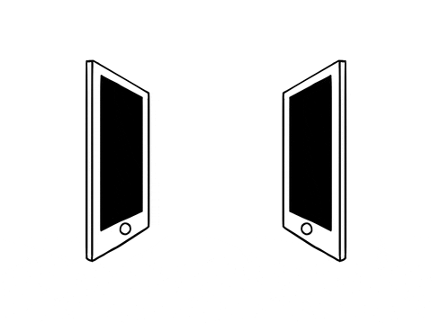

  

# Welcome to My GitHub Profile 🚀

 

  

 

---

### 👋 Hi, I'm **Vraj Patel**

- 🎓 Physics & Astronomy undergraduate with a strong interest in **Aerospace Engineering**
- 🛰️ Aspiring researcher/engineer working at the intersection of **space systems, simulations, and data analysis**
- 🌌 Interested in **orbital mechanics, multibody dynamics, and space mission design**

 

  

---

### 🔭 Currently Working On
- 📊 **F1 race analytics & overtake detection** using Python, FastF1, and Dash  
- 🪐 **Planet formation modeling** using numerical simulations (Helled & Bodenheimer–style accretion models)  
- 🧮 Physics-based simulations involving **orbital perturbations, detectors, and signal analysis**

---

### 🌱 Currently Learning
**Python | C++ | Numerical Methods | Orbital Mechanics | Control Systems | Data Visualization**

---

  

---

### 💬 Ask Me About
- Physics & Astronomy 🔭  
- Aerospace & Orbital Dynamics 🚀  
- Scientific Computing & Simulations 💻  
- Data Analysis & Visualization 📈  

---

### 🤓 Active On
**GitHub | LinkedIn**

---

### 📫 How to Reach Me
- 📧 [**Drop a Mail**](mailto:your.email@domain.com)
- 🔗 [**Connect on LinkedIn**](https://www.linkedin.com/in/your-linkedin/)
- 🌐 [**Visit My Portfolio**](https://your-website.com)

  

---

### ⚡ Fun Facts
- *Enjoys translating complex physics into clean, readable code — and occasionally into plots that actually make sense 📊😄*
- *Equally excited by space missions, fast cars, and well-optimized algorithms 🛰️🏎️*

 
